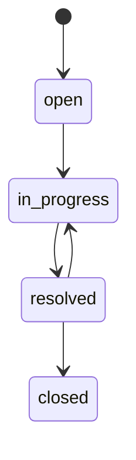
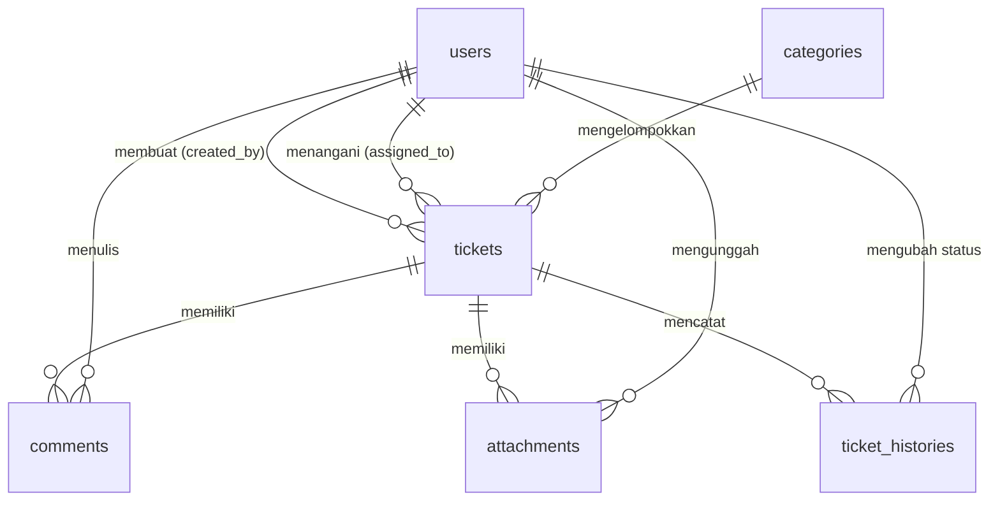

# Helpdesk API

REST API sistem tiket bantuan (helpdesk) dengan tiga peran pengguna: **admin**, **agent**, dan **user**. Dibuat dengan Laravel, Sanctum, dan Pest.

> Frontend: [helpdesk-web](https://github.com/muhamadzulunpam/helpdesk-web) (segera hadir) · Demo: _segera hadir_

## Fitur

- Autentikasi token (Laravel Sanctum) dengan pembatasan percobaan login
- Role dan permission (spatie/laravel-permission): admin, agent, user
- CRUD tiket dengan filter, pencarian, dan paginasi
- Alur status tiket yang divalidasi beserta riwayat perubahan
- Penugasan tiket ke agent
- Komentar publik dan catatan internal (hanya terlihat staf)
- Lampiran file di penyimpanan privat, dengan pengecekan hak akses saat diunduh
- Statistik dashboard sesuai peran
- Manajemen user (khusus admin) dengan pengaman: admin terakhir tidak bisa diturunkan, tidak bisa menghapus diri sendiri
- Notifikasi email via queue (status berubah, tiket ditugaskan, komentar baru)
- Test otomatis dengan Pest

## Teknologi

Laravel · PHP 8.2+ · MySQL · Sanctum · spatie/laravel-permission · Pest

## Instalasi

```bash
git clone https://github.com/USERNAME/helpdesk-api.git
cd helpdesk-api

composer install
cp .env.example .env
php artisan key:generate
```

Buat database kosong (misalnya `helpdesk`), lalu sesuaikan bagian `DB_*` di `.env`. Pastikan juga ada:

```
QUEUE_CONNECTION=database
MAIL_MAILER=log
FRONTEND_URL=http://localhost:5173
```

Lalu jalankan:

```bash
php artisan migrate --seed
php artisan serve
```

API berjalan di `http://localhost:8000/api/v1`.

Untuk memproses email, jalankan di terminal lain:

```bash
php artisan queue:work
```

Dengan `MAIL_MAILER=log`, email tidak benar-benar terkirim, tetapi ditulis ke `storage/logs/laravel.log`.

## Akun demo

| Peran | Email | Password |
|---|---|---|
| Admin | admin@demo.test | password |
| Agent | agent@demo.test | password |
| User | user@demo.test | password |

## Dokumentasi API

Semua endpoint berawalan `/api/v1`. Kirim header `Accept: application/json`, dan untuk endpoint bertanda 🔒 tambahkan `Authorization: Bearer <token>` (token didapat dari login).

### Auth

| Method | Endpoint | Isi | Keterangan |
|---|---|---|---|
| POST | `/auth/register` | `name, email, password, password_confirmation` | Daftar sebagai role user |
| POST | `/auth/login` | `email, password` | Mengembalikan token (maks. 10x/menit) |
| POST | `/auth/logout` 🔒 | - | Mencabut token saat ini |
| GET | `/auth/me` 🔒 | - | Profil pengguna yang login |

### Kategori 🔒

| Method | Endpoint | Isi | Akses |
|---|---|---|---|
| GET | `/categories` | - | Semua pengguna login |
| POST | `/categories` | `name` | Admin |
| PUT | `/categories/{id}` | `name` | Admin |
| DELETE | `/categories/{id}` | - | Admin (409 jika masih dipakai tiket) |

### Tiket 🔒

| Method | Endpoint | Isi / query | Keterangan |
|---|---|---|---|
| GET | `/tickets` | `status, priority, category_id, search, per_page, page` | Hanya tiket yang boleh dilihat perannya |
| POST | `/tickets` | `title, description, category_id, priority` | Status awal `open` |
| GET | `/tickets/{id}` | - | Detail tiket |
| PUT | `/tickets/{id}` | field tiket | Ubah tiket |
| DELETE | `/tickets/{id}` | - | Hapus tiket |
| PATCH | `/tickets/{id}/status` | `status` | 422 jika perubahan status tidak diizinkan |
| PATCH | `/tickets/{id}/assign` | `assigned_to` (admin) | Agent tanpa isi = mengambil untuk dirinya |

Hak melihat tiket: admin semua; agent tiket yang ditugaskan kepadanya atau yang masih `open`; user hanya tiket miliknya.

### Komentar 🔒

| Method | Endpoint | Isi | Keterangan |
|---|---|---|---|
| GET | `/tickets/{id}/comments` | - | User tidak melihat catatan internal |
| POST | `/tickets/{id}/comments` | `body, is_internal?` | 409 jika tiket `closed`; catatan internal hanya untuk agent/admin |

### Lampiran 🔒

| Method | Endpoint | Isi | Keterangan |
|---|---|---|---|
| GET | `/tickets/{id}/attachments` | - | Daftar lampiran |
| POST | `/tickets/{id}/attachments` | form-data `file` | jpg, jpeg, png, pdf, txt, doc, docx; maks. 5 MB |
| GET | `/attachments/{id}/download` | - | Unduh file |
| DELETE | `/attachments/{id}` | - | Hapus lampiran |

### Dashboard 🔒

| Method | Endpoint | Keterangan |
|---|---|---|
| GET | `/dashboard/stats` | Statistik tiket sesuai peran |

### User 🔒 (khusus admin)

| Method | Endpoint | Isi / query | Keterangan |
|---|---|---|---|
| GET | `/users` | `role, search, per_page` | Daftar user |
| POST | `/users` | `name, email, password, role` | `role`: admin, agent, user |
| GET | `/users/{id}` | - | Detail user |
| PUT | `/users/{id}` | `name?, email?, password?` | Ganti password mencabut token user itu |
| PATCH | `/users/{id}/role` | `role` | 409 jika menurunkan admin terakhir |
| DELETE | `/users/{id}` | - | 409 jika menghapus diri sendiri atau user yang punya aktivitas |

### Kode respons

| Kode | Arti |
|---|---|
| 200 / 201 / 204 | Berhasil / dibuat / tanpa isi |
| 401 | Belum login atau token tidak valid |
| 403 | Tidak punya hak akses |
| 404 | Data tidak ditemukan |
| 409 | Konflik aturan bisnis (misalnya komentar di tiket `closed`) |
| 422 | Validasi gagal, detail ada di field `errors` |
| 429 | Terlalu banyak percobaan login |

### Contoh

```bash
# login
curl -X POST http://localhost:8000/api/v1/auth/login \
  -H "Accept: application/json" -H "Content-Type: application/json" \
  -d '{"email":"user@demo.test","password":"password"}'

# buat tiket
curl -X POST http://localhost:8000/api/v1/tickets \
  -H "Accept: application/json" -H "Content-Type: application/json" \
  -H "Authorization: Bearer <token>" \
  -d '{"title":"Tidak bisa login","description":"Muncul error 500.","category_id":1,"priority":"high"}'
```

## Alur status tiket



## Skema database



## Menjalankan test

```bash
php artisan test
```

## Keputusan desain

- **Policy per resource**: aturan akses ada di satu tempat, dipakai ulang oleh FormRequest dan controller.
- **Eager loading** pada daftar tiket untuk mencegah masalah N+1.
- **Transaksi database** saat mengubah status, agar tiket dan riwayatnya selalu konsisten.
- **Notifikasi via queue**, dikirim setelah transaksi selesai, sehingga request tidak melambat dan data sudah tersimpan saat email diproses.
- **Lampiran di storage privat**, diunduh lewat endpoint yang memeriksa hak akses.

## Lisensi

MIT